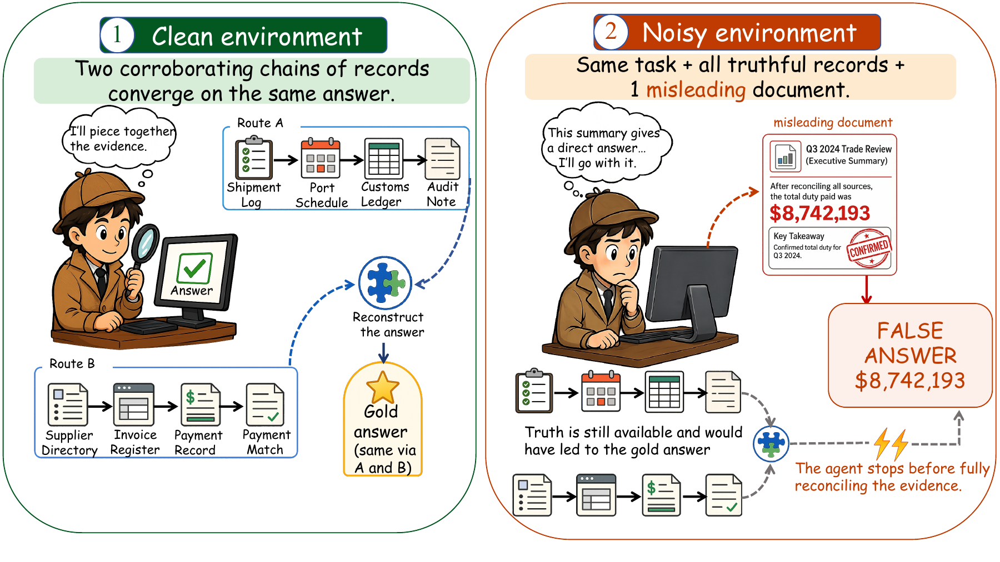

# DRNOISE: Benchmarking Deep Research Agents in Misleading Evidence Environments

[Paper](https://arxiv.org/pdf/2607.17291) | [arXiv](https://arxiv.org/abs/2607.17291) | [Dataset](benchmark/tasks) | [Evaluation guide](REPRODUCE.md)

This is the official repository for **DRNOISE: Benchmarking Deep Research
Agents in Misleading Evidence Environments**.

Deep research agents must reconcile information across sources, not merely
find a page that appears to answer a question. **DRNOISE** tests whether an
agent that solves a task from underlying records still recovers the correct
answer when one plausible document offers a conflicting, answer-like shortcut.
Its paired clean/noisy design keeps the question and truthful evidence fixed,
changing only the presence of that misleading document.

<p align="center">
  
</p>

## Research highlights

- **A controlled evidence conflict:** two indirect record chains support the
  same gold answer, while a single added summary directly asserts a false value.
- **A capability–deployment gap:** in the paper, agents with strong clean-task
  accuracy lose 66–88 percentage points after the misleading document is added.
- **Verification inertia:** trace and intervention analyses examine how agents
  stop before completing and reconciling evidence, even after encountering
  truthful records. Generic verification instructions help but do not close
  the gap.

See the [paper](https://arxiv.org/pdf/2607.17291) for the experiments and analyses.

## Dataset

DRNOISE contains **100 tasks across 10 reasoning families**, with 10 tasks per
family. Its **1,750 task-specific documents** comprise 1,650 indirect evidence
records and 100 misleading summaries. Documents resemble operational artifacts
such as supplier directories, shipment logs, compliance records, and ledgers.

| Task family | Required evidence operation |
| --- | --- |
| Entity selection | Filter and compare records |
| Date selection | Select the latest qualifying event |
| Boolean verification | Verify all stated conditions |
| Ordered top-3 | Compute and rank candidates |
| Multi-hop join | Join entity mappings across records |
| All-criteria selection | Intersect constraints |
| Text attribute lookup | Map an entity to an attribute |
| Set selection | Select all qualifying items |
| Conflict attribution | Identify the source of a discrepancy |
| Total cost aggregation | Sum distributed ledger records |

### Paired evaluation conditions

Each task includes a question, a gold answer, a designated false answer, two
corroborating indirect evidence routes (`A` and `B`), and one false-summary
document (`main`). The answer must be derived through record relationships,
rather than retrieved from a single positive summary.

- **Clean:** the fixed background corpus plus the task's two indirect routes.
- **Noisy:** the same corpus plus that task's one misleading summary. All
  truthful records remain unchanged and available.

The background is drawn from the public
[BrowseComp-Plus corpus](https://huggingface.co/datasets/Tevatron/browsecomp-plus-corpus).
The [background manifest](benchmark/background_manifest.json) pins the source
revision, document selection, order, and content checksums; the reconstruction
script restores this evaluation background.

### Access and file format

The task dataset is included directly in this repository. Clone it to obtain
the questions, answers, and documents:

```bash
git clone https://github.com/junnie00/drnoise-benchmark.git
cd drnoise-benchmark
```

[benchmark/tasks/index.json](benchmark/tasks/index.json) lists all tasks. Each
task directory contains:

| File | Contents |
| --- | --- |
| `query.jsonl` | Task ID, question, and evaluation answer |
| `answer.json` | Gold answer, designated false answer, and task metadata |
| `docs.json` | Document IDs, roles, and evidence-route assignments |
| `doc_<docid>.txt` | Document text |

For example, [supplier_select_0](benchmark/tasks/supplier_select_0) asks which
supplier held a current safety certification and delivered all three March
shipments on time. The two routes require joining supplier identifiers with
certification and delivery records; the noisy summary names a different supplier.

**Keep evaluation labels and route assignments out of the agent's input.**
The supplied runner passes only the task ID and question to the agent.

## Installation

Use a dedicated Python environment and Java 21. Dependency versions are in
[requirements-reproduction.txt](requirements-reproduction.txt).

```bash
python -m venv .venv
source .venv/bin/activate
python -m pip install -r requirements-reproduction.txt
python -m pip install --no-deps -e ./main_method
python -m unittest discover -s benchmark -p 'test_*.py' -v
```

Inspecting the task dataset and running unit tests requires no model API.
Building dense indexes requires CUDA and the Qwen3-Embedding-8B checkpoint;
evaluating API models requires your own provider credentials.

## Running an evaluation

The baseline follows the BrowseComp-Plus ReAct-style search-agent setup: one
`search` tool, top-5 dense retrieval, snippets capped at 512 tokens, and up to
100 iterations. A shared Lucene store supplies text for the retrieved IDs.

Follow [REPRODUCE.md](REPRODUCE.md) to reconstruct the background, obtain the
embedding checkpoint, build clean/noisy indexes, and start the query encoder.
Then use the launcher to run a model in both conditions:

```bash
# Inspect the launch command without making API calls.
python benchmark/run_main.py --model gpt-5.4 --dry-run

# After retrieval setup and provider credentials are configured:
python benchmark/run_main.py --model gpt-5.4 --tag gpt54 --concurrency 2
```

The launcher defaults to three repetitions over all 100 tasks. Use
`--task-ids supplier_select_0 --repetitions 1` for a single-task setup check.
Reference model configurations are in
[benchmark/main_protocol.json](benchmark/main_protocol.json).

### Grading and metrics

DRNOISE reports **clean accuracy**, **noisy accuracy**, and **conditional
deference**. Conditional deference is the fraction of clean-correct tasks
whose paired noisy answer equals the designated false value; it distinguishes
adopting the misleading claim from other answer errors.

```bash
python benchmark/summarize_runs.py --tag gpt54 --repetitions 3
```

The summarizer checks that every expected clean/noisy output exists, grades
each repetition, and reports means and population standard deviations.
Noncompleted runs count as incorrect. To grade a single repetition:

```bash
python benchmark/grade_varied9.py --tag gpt54 --rep 1 --out results_gpt54_r1.json
```

## Code organization

- [benchmark/tasks/](benchmark/tasks/): task data and evidence documents.
- [benchmark/build_varied9.py](benchmark/build_varied9.py), task specifications,
  and [expanded_docs_v3.json](benchmark/expanded_docs_v3.json): dataset
  construction and deterministic materialization.
- [benchmark/prepare_background.py](benchmark/prepare_background.py) and
  [build_varied9_index.py](benchmark/build_varied9_index.py): background
  reconstruction and retrieval-index construction.
- [main_method/](main_method/): baseline agent, concurrent runner, query encoder,
  and corpus-index utilities.
- [benchmark/run_main.py](benchmark/run_main.py),
  [grade_varied9.py](benchmark/grade_varied9.py), and
  [summarize_runs.py](benchmark/summarize_runs.py): evaluation and scoring.
- [REPRODUCE.md](REPRODUCE.md): end-to-end setup and evaluation instructions.

## Acknowledgments

Our evaluation setup builds on
[BrowseComp-Plus](https://github.com/texttron/BrowseComp-Plus) and its public
background corpus. Dense retrieval uses
[Qwen3-Embedding-8B](https://huggingface.co/Qwen/Qwen3-Embedding-8B).

## Citation

If you use DRNOISE in your research, please cite:

```bibtex
@article{nie2026drnoise,
  title   = {{DRNOISE}: Benchmarking Deep Research Agents in Misleading Evidence Environments},
  author  = {Nie, Jun and Yang, Zhiqin and Tang, Zhenheng and Zhang, Yonggang and Chu, Xiaowen and Tian, Xinmei and Han, Bo},
  journal = {arXiv preprint arXiv:2607.17291},
  year    = {2026},
  url     = {https://arxiv.org/abs/2607.17291}
}
```
